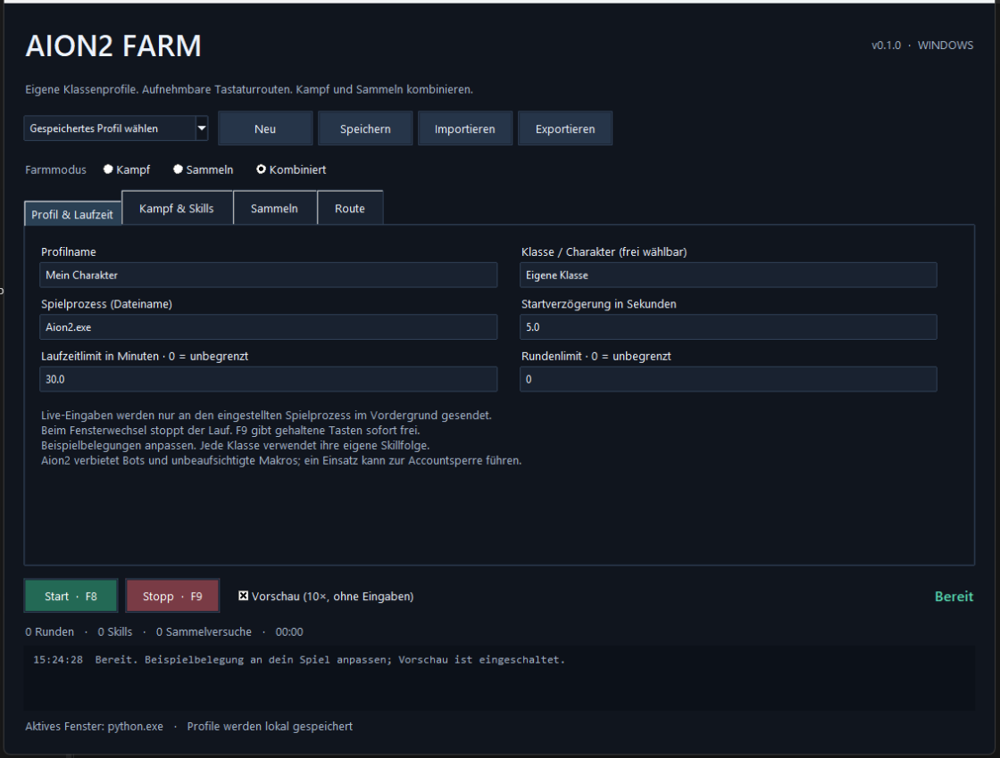

# AION2 Farm

Konfigurierbare Windows-App für zeitgesteuerte Kampf- und Sammelroutinen. Klassenunabhängige Profile, aufnehmbare Tastaturrouten und kombinierbare Aktionspunkte. Deutsche Oberfläche, lokale JSON-Profile, keine Anmeldung.



**Version 0.1 ist ein Bot für feste Tastenfolgen und zeitgesteuerte Routen.** Gegner, Ressourcen, Lebenspunkte, Hindernisse, Position und Inventar werden nicht erkannt. Es gibt keine automatische Wegfindung. Im Spiel sind die Routengenauigkeit und die Annahme simulierter Eingaben noch nicht verifiziert.

Aion2 untersagt Bots und unbeaufsichtigte Makros; ein Einsatz kann zur Accountsperre führen. Siehe [offizielle Regeln](https://help.plaync.com/faq/aion2global/view?faqNo=7164). Die App verwendet normale Windows-Eingaben. Sie verändert keine Spieldateien und bietet keine Umgehung von Schutzsystemen.

## Start

1. Unter **Releases** `Aion2Farm.exe` herunterladen und starten. Windows 10/11, x64; Python wird für die EXE nicht benötigt. Die EXE ist nicht codesigniert.
2. Profilname und Klasse eintragen. Alle Klassen verwenden denselben Ablauf; Tasten, Skills und Zeiten sind je Profil frei konfigurierbar. Die eingebauten Belegungen sind Beispiele und müssen angepasst werden.
3. Den Prozessnamen des Spielfensters prüfen, standardmäßig `Aion2.exe`. Unter der App steht der Dateiname des jeweils aktiven Fensters.
4. **Kampf**, **Sammeln** oder **Kombiniert** auswählen und die jeweiligen Tasten einstellen.
5. Mit eingeschalteter **Vorschau** starten. Diese läuft zehnfach beschleunigt, protokolliert die Aktionen und sendet keine Eingaben. Die Startverzögerung läuft in Echtzeit.
6. Profil speichern. Für echte Eingaben die Vorschau deaktivieren, F8 drücken und innerhalb der Startverzögerung ins Spielfenster wechseln. F9 stoppt jederzeit.

## Routen aufnehmen

- Im Reiter **Route** die aufzunehmenden Bewegungstasten einstellen. Es werden ausschließlich diese Tastaturtasten und nur während des Spielfokus aufgezeichnet.
- F10 startet nach der eingestellten Verzögerung die Aufnahme. Vorher stillstehen und ins Spiel wechseln.
- Route mit der Tastatur ablaufen. Die Aufzeichnung enthält Tastenkombinationen, Haltezeiten und Wartezeiten.
- Am gewünschten Punkt alle Bewegungstasten loslassen: **F6** setzt einen Kampfpunkt, **F7** einen Sammelpunkt. Die Dauer kommt aus dem jeweiligen Reiter. Danach weiterlaufen; die Kampf- oder Sammelaktion während der Aufnahme muss nicht selbst ausgeführt werden.
- F10 beendet die Aufnahme. F9 beendet sie ebenfalls und behält das Aufgenommene. Neue Aufnahmen werden an die bestehende Route angehängt.
- Die Route prüfen und speichern. Schritte lassen sich hinzufügen, bearbeiten, verschieben oder entfernen.
- Kamerabewegungen und Mausklicks werden **nicht aufgenommen**. Einen Schritt **Maus bewegen** ergänzen, bei Bedarf mit `rightmouse` als gehaltener Taste. X und Y sind relative Mausbewegungen und müssen auf die Empfindlichkeit des Spiels abgestimmt werden.
- Die Route muss zum Startpunkt zurückführen; jede Runde beginnt dort erneut. Feste Wege können durch Kollisionen, unterschiedliche Laufgeschwindigkeit oder Kameraposition abweichen.

Im Kampfmodus werden Sammelpunkte übersprungen, im Sammelmodus Kampfpunkte. Der kombinierte Modus führt beide aus. Eine Route braucht für jeden ausgewählten Modus mindestens einen passenden Aktionspunkt. Ohne Route bleibt der Charakter am aktuellen Standort und wiederholt die ausgewählten Aktionen.

## Klassenprofile und Skills

- Frei wählbarer Klassenname und beliebig viele Profile; keine hart codierten Klassenrotationsdaten.
- Bereite Skills werden reihum abgearbeitet. Pro Skill gelten ein Cooldown und eine Pause nach der Taste. Das sind lokale Zeitgeber, keine aus dem Spiel gelesenen Cooldowns.
- Auch Buffs oder Verbrauchsgegenstände lassen sich als Skill mit passendem Intervall eintragen. Es gibt keine Lebenspunkterkennung für bedarfsabhängige Heilung.
- Tasten: `a`–`z`, `0`–`9`, `tab`, `space`, `enter`, `escape`, `shift`, `ctrl`, `alt`, Pfeiltasten, `home`, `end`, `insert`, `delete`, `pageup`, `pagedown`, `backspace`, `leftmouse`, `rightmouse`, `middlemouse` und F1–F12 außer F6–F10. Kombinationen etwa `shift+1` oder `ctrl+2`. Sonderzeichen und Numpad-Tasten werden derzeit nicht unterstützt.
- Zielwechsel und Looten sind zeitgesteuert. Ein leeres Tastenfeld deaktiviert diese beiden Aktionen.
- Lokale Profile: `%LOCALAPPDATA%\Aion2Farm\profiles`. Über Import/Export lassen sich JSON-Profile übertragen. Profile führen keinen Code aus.

| Hotkey | Funktion |
| --- | --- |
| F6 | Kampfpunkt während der Aufnahme |
| F7 | Sammelpunkt während der Aufnahme |
| F8 | Lauf starten |
| F9 | Lauf/Aufnahme stoppen, gehaltene Tasten freigeben |
| F10 | Aufnahme starten/beenden |

Die fünf Hotkeys werden von der App global reserviert. Bei Fokusverlust stoppt ein Live-Lauf. Live-Start ist gesperrt, wenn F9 bereits von einem anderen Programm belegt ist. Standardmäßig endet ein Lauf nach 30 Minuten; zusätzlich ist ein Rundenlimit möglich. Beide Limits können bewusst auf 0 gesetzt werden.

## Entwicklung

Python 3.12 unter Windows mit Tkinter. Zur Ausführung aus dem Quellcode sind keine zusätzlichen Python-Pakete nötig:

```powershell
python run.py
python -m unittest discover -s tests -v
python run.py --smoke-test --report artifacts/smoke.json
```

Für den letzten Befehl zuerst `artifacts` anlegen. Der Smoke-Test prüft die komplette Vorschau über die Oberfläche; globale Hooks und echte Eingaben bleiben dabei deaktiviert. Optional kann `--screenshot artifacts/app.png` mit installiertem Pillow verwendet werden.

Windows-EXE bauen, testen und Prüfsumme erzeugen:

```powershell
./build.ps1
```

Das Skript installiert die Build-Abhängigkeiten in `.venv`. GitHub Actions führt denselben Build mit Kern-, Windows-Adapter- und EXE-Vorschautests aus.

Getestet werden unter anderem Modusauswahl, Profilimport, Route mit Tastenkombinationen, Rotation, Zeitlimit, Fokusverlust und Stopp während einer gehaltenen Taste. Automatisierte Tests erzeugen keine Spieleingaben. Ein erfolgreicher Build bestätigt keine Funktion im Aion2-Client.
